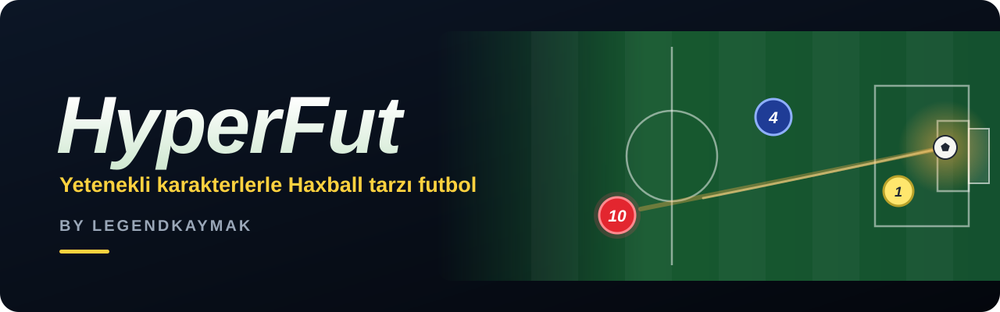
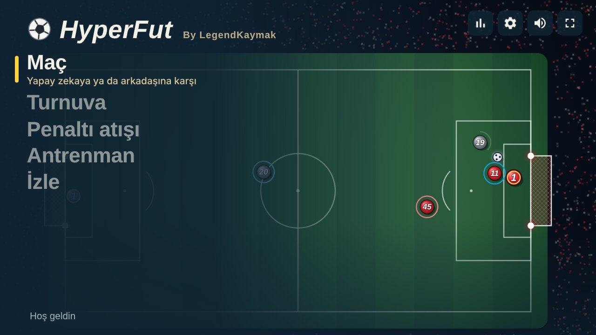
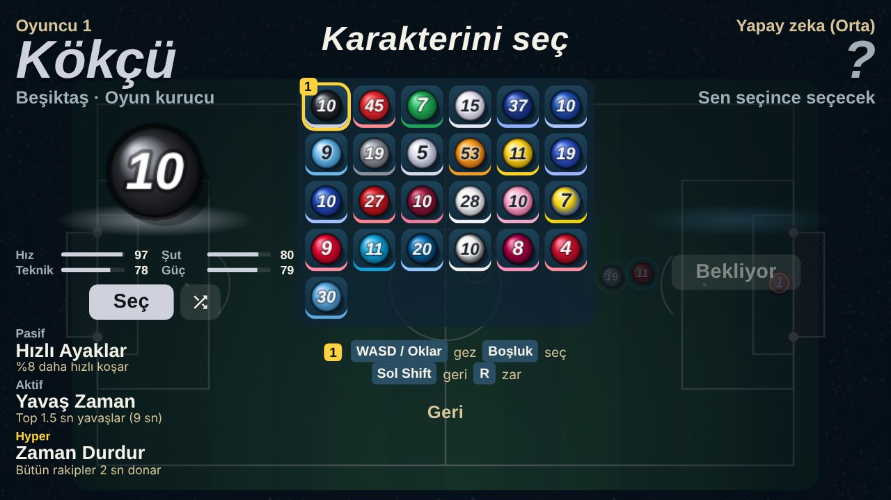
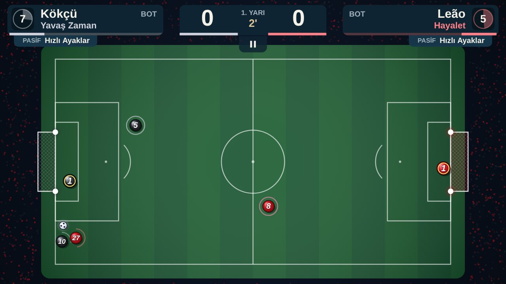
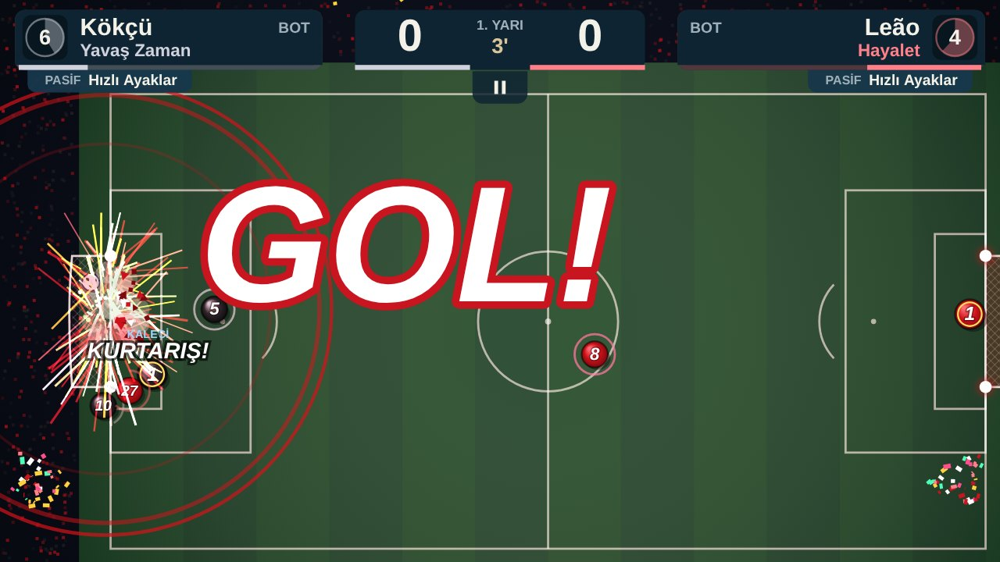

<div align="center">



<br>

[](https://hyperfut-legend-kaymak.vercel.app)


**Haxball tarzı, hızlı ve kaotik tarayıcı futbolu.**<br>
Her karakterin kendi pasifi, yeteneği ve maçı çeviren bir **Hyper**'ı var.

</div>

---

## 📸 Ekran görüntüleri

<table>
  <tr>
    <td width="50%"></td>
    <td width="50%"></td>
  </tr>
  <tr>
    <td align="center"><sub>Ana menü, arkada canlı bot maçı</sub></td>
    <td align="center"><sub>Karakter seçimi</sub></td>
  </tr>
  <tr>
    <td width="50%"></td>
    <td width="50%"></td>
  </tr>
  <tr>
    <td align="center"><sub>3v3 Tam Kadro maçı</sub></td>
    <td align="center"><sub>Gol patlaması ve kurtarış</sub></td>
  </tr>
</table>

## ✨ Özellikler

| | |
|---|---|
| ⚽ **Haxball fiziği** | Topu sürmek, basılı tutup vurmak, direkten dönen toplar |
| 🦸 **25 karakter** | Her birinde pasif + aktif yetenek + Hyper |
| ⚡ **Hyper barı** | Topa dokundukça dolar, dolunca yetenek süper güce dönüşür |
| 🏆 **5 mod** | Maç, Turnuva (2–8 kişi), Penaltı atışı, Antrenman, İzle |
| 👥 **3 format** | Düello (1v1), Kale Savaşı (2v2), Tam Kadro (3v3) |
| 🏟️ **6 saha** | Gece, Gündüz, Kar, Yağmur, Plaj, Futsal; her zeminin fiziği farklı |
| 🤖 **Yapay zeka** | 3 zorlukta bot, 5 seviye kaleci, pas atan takım arkadaşı |
| 🎬 **Gol tekrarı** | Her golden sonra ağır çekim tekrar |
| 🏅 **Başarımlar** | 11 başarım, kariyer istatistikleri, galibiyet serisi |
| 🎮 **Kontrol** | Aynı klavyede 2 oyuncu, oyun kolu, dokunmatik joystick |
| 📱 **Uygulama** | Telefona ve bilgisayara yüklenir, internetsiz çalışır |
| 🔊 **Ses** | Tamamen kodla üretilen efektler ve seyirci sesi |

## 🎮 Kontroller

| | Oyuncu 1 | Oyuncu 2 | Oyun kolu |
|---|:---:|:---:|:---:|
| Hareket | `W` `A` `S` `D` | `↑` `←` `↓` `→` | Sol çubuk / D-pad |
| Şut (basılı tut) | `Boşluk` | `Enter` | `A` |
| Yetenek / Hyper | `Sol Shift` | `Sağ Shift` | `B` / `X` |
| Duraklat | `Esc` | `Esc` | `Start` |

`M` sesi açıp kapatır. Tuşlar **Ayarlar → Kontroller** menüsünden değiştirilebilir. Telefonda ekranın soluna dokunup sürükleyerek hareket edersin, sağdaki düğmelerle şut atıp yetenek kullanırsın.

## 🦸 Karakterler

<details>
<summary><b>25 karakterin tamamını gör</b></summary>
<br>

| # | Karakter | Takım | Rol | Pasif | Aktif | Hyper |
|:-:|---|---|---|---|---|---|
| 10 | **Kökçü** ⭐ | Beşiktaş | Oyun kurucu | Hızlı Ayaklar | Yavaş Zaman | Zaman Durdur |
| 45 | **Osimhen** | Galatasaray | Santrfor | Hızlı Ayaklar | Güç Şutu | Lav Yağmuru |
| 7 | **Vinícius** | Real Madrid | Sol kanat | Çevik | Atılma | Pike |
| 15 | **Arda Güler** | Real Madrid | Falso ustası | Hızlı Ayaklar | Falso | Büyülü Kıvrım |
| 37 | **Škriniar** | Fenerbahçe | Stoper | Dev Disk | Kalkan | Kale Duvarı |
| 10 | **Yamal** | Barcelona | Top cambazı | Yapışkan Top | Mıknatıs | Süper Mıknatıs |
| 9 | **Haaland** | Manchester City | Santrfor | Sert Şut | Şok Dalgası | Göktaşı |
| 19 | **Trossard** | Beşiktaş | Akıllı forvet | Hızlı Ayaklar | Işınlanma | Gölge Adımı |
| 5 | **Bellingham** | Real Madrid | Box-to-box | Çevik | Dondur | Buz Devri |
| 53 | **Barış Alper** | Galatasaray | Enerji | Dev Disk | Şaşırt | Kâbus |
| 11 | **Greenwood** | Fenerbahçe | Kanat | Çevik | Rüzgâr | Kasırga |
| 19 | **Muriqi** | Fenerbahçe | Pivot santrfor | Sert Şut | Şişme | Dev Tunç |
| 10 | **Mbappé** | Real Madrid | Şimşek | Çevik | Turbo | Işık Hızı |
| 27 | **Leão** | Galatasaray | Kanat | Hızlı Ayaklar | Hayalet | Aynalar Salonu |
| 10 | **Salah** | Trabzonspor | Kral | Sert Şut | Kara Delik | Süpernova |
| 28 | **Vlahović** | Beşiktaş | Hedef santrfor | Dev Disk | Kök Sal | Derin Kök |
| 10 | **Messi** | Inter Miami | Efsane | Yapışkan Top | Solo Çalım | Keçi Modu |
| 7 | **Ronaldo** | Al Nassr | Golcü | Sert Şut | Roket Şut | SİUUU |
| 9 | **Kane** | Bayern | Bitirici | Sert Şut | Nişancı | Kaptan |
| 11 | **De Bruyne** | Napoli | Pas ustası | Çevik | Rüzgâr | Kontra Atak |
| 20 | **Çalhanoğlu** | Inter | Frikik ustası | Sert Şut | Frikik | Uzaktan Füze |
| 10 | **Kenan Yıldız** | Juventus | Genç yıldız | Çevik | Atılma | Yıldız Kayması |
| 8 | **Pedri** | Barcelona | Tiki-taka | Hızlı Ayaklar | Boşluk Bul | Tiki-Taka |
| 4 | **Van Dijk** | Liverpool | Duvar stoper | Dev Disk | Müdahale | Kaya |
| 30 | **Onuachu** 🐢 | Trabzonspor | Hantal santrfor | Hantal | Kafa Vuruşu | Tökezleme |

⭐ Takımın yıldızı, diğerlerinden biraz daha güçlü. &nbsp; 🐢 Oyunun en kötüsü, kendi riskinle seç.

</details>

## 📱 Uygulama olarak yükle

- **Android / Chrome / Edge:** Ana menüdeki **Uygulamayı yükle** düğmesine bas.
- **iPhone / iPad:** Safari'de **Paylaş → Ana Ekrana Ekle**.

Yüklendikten sonra tam ekran açılır ve internet olmadan da oynanır.

## 🛠️ Yerelde çalıştırma

Derleme ya da paket kurulumu gerekmez; saf HTML, CSS ve JavaScript.

```bash
git clone https://github.com/LegendKaymak/HyperFut.git
cd HyperFut
python3 -m http.server 8000
# tarayıcıda http://localhost:8000
```

<details>
<summary><b>Dosya yapısı</b></summary>

```
├── index.html             # giriş sayfası ve HUD
├── app.css                # arayüz stilleri
├── data.js                # karakterler, yetenekler, sahalar, ayarlar
├── sfx.js                 # Web Audio ile üretilen sesler
├── game.js                # fizik, yetenekler, yapay zeka, penaltılar
├── draw.js                # Canvas 2D çizim ve efektler
├── ui.js                  # menüler, turnuva, giriş (klavye/kol/dokunmatik)
├── sw.js                  # çevrimdışı önbellek (service worker)
├── manifest.webmanifest   # PWA bilgileri
└── icon-192.png
```

</details>

---

<div align="center">
<sub>Made by <b>LegendKaymak</b></sub>
</div>
